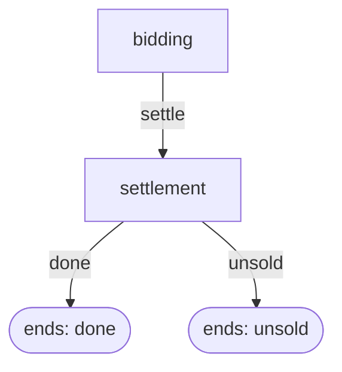

# Sealed-bid auction with a public reserve price

One item is sold. Every bidder knows its own value and sends one sealed bid; the highest bid at or above the reserve wins and, under the second-price rule, pays the larger of the reserve and the highest other bid.

## Who takes part

- **bidder** (several): Wants the item and knows what it is worth to them.

## Step by step

1. **bidding**: All bidders send a sealed bid without seeing any other bid. At the same time: bidder chooses `amount`.
2. **settlement** (automatic, nobody decides): The rule picks the winner and the price, or declares the item unsold.

## How the steps connect



```text
sequence auction -> done, unsold
  first: step bidding -> settle
  on settle: step settlement -> done, unsold
```

## Who knows what

Taken from runs of the built environment, not from the description above.

| Step | Role | Sees when deciding | Chooses | Is told afterwards |
| --- | --- | --- | --- | --- |
| bidding | bidder | `bid_disclosure`, `bidders`, `reserve`, `rule`, `tie_break`, `value` | `amount` | `own_bid`, `status` |
| settlement | bidder | (does not decide) | (does not decide) | `all_bids`, `own_bid`, `own_payment`, `own_utility`, `reserve`, `status`, `winner`, `winning_payment` |

## What is committed and what is chosen

- Chosen live by participants: bidding.
- Fixed by the rules (automatic): settlement.

## If someone does not act

- **bidding**: the run stops.

## What repeats and what carries over

Nothing repeats.

## What must stay secret

- A bidder's value is known only to that bidder. Must never reach: bidder (except alice, who may know it). Tested by changing `values`.

## Payoffs

- **bidder**: The winner gets its value minus the price; everyone else gets 0. It is told to them in the report field `own_utility`.

## What must always hold

- A bidder who does not win pays nothing. (not checked automatically)
- If the item is sold, the price is at least the reserve. (not checked automatically)

## Parameters of this design

- `reserve` = `2.0`
- `reveal_bids` = `false`
- `rule` = `"second_price"`
- `values` = `{"alice": 10.0, "bob": 7.0, "carol": 4.0}`

## What is stylized

The numbers are illustrative. This page describes the rules of the simulated institution; it makes no claim that they match a real market, city or organization.

## Choices nobody has confirmed yet

- [ ] If two bidders tie for the highest bid, the one whose name comes first alphabetically wins. (question 1)
- [ ] Under the second-price rule the reserve acts like a bid by the seller: the winner pays the larger of the reserve and the highest other bid. (question 3)
- [ ] A bid exactly equal to the reserve can win; bids below the reserve are ignored, and if none clears it the item is unsold and nobody pays. (question 3)
- [ ] The reserve, the pricing rule, the tie-break rule and the names of all bidders are shown to every bidder before bidding. (question 2)
- [ ] If any bidder sends no bid, the whole run stops; a missing bid is not treated as a bid of zero. (question 7)
- [ ] A bidder may bid more than its value and can end with a negative payoff. (question 9)
- [ ] After settlement every bidder is told the winner's name and what the winner paid, and its own bid, payment and payoff; other bids are shown only when reveal_bids is on. (question 8)
