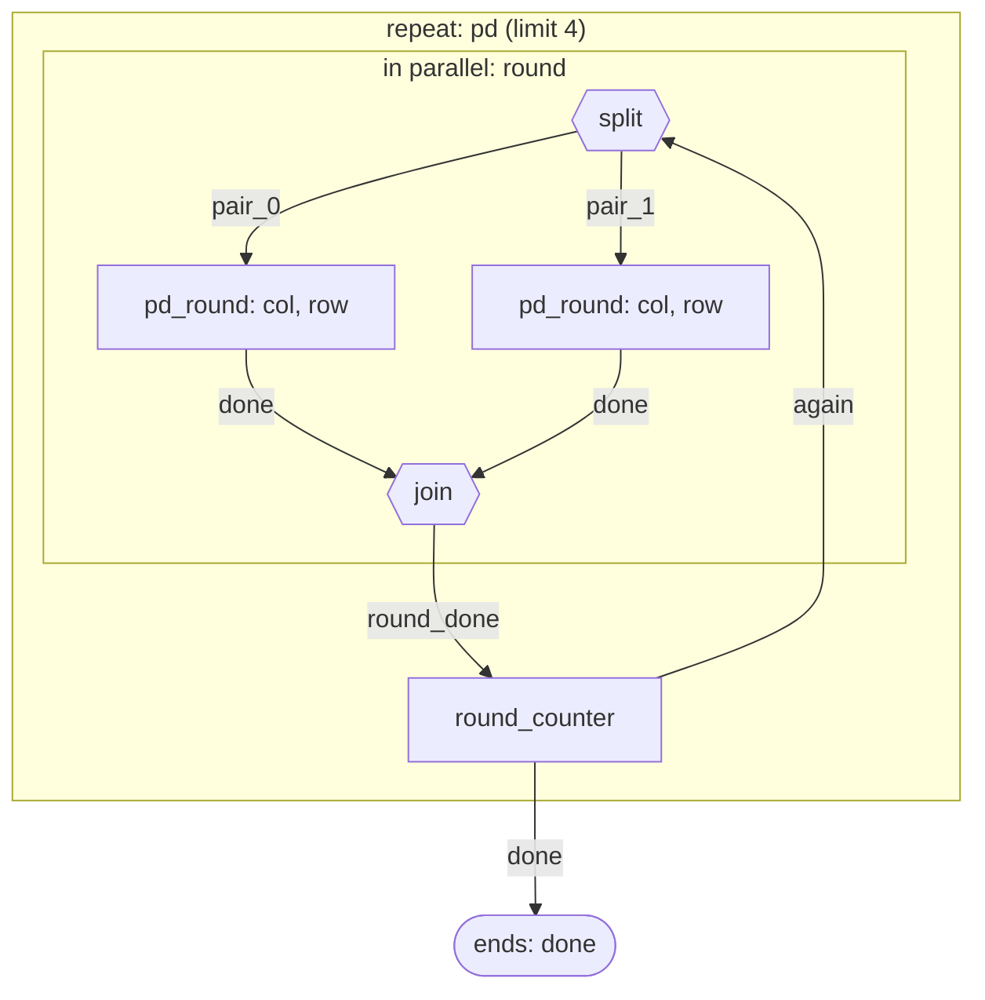

# Repeated prisoner's dilemma in pairs

Players are paired. In every round both players of a pair choose to cooperate (C) or defect (D) at the same time, learn the other's move and their own payoff, and play again.

## Who takes part

- **row** (several): The first player of a pair.
- **col** (several): The second player of a pair.

## Step by step

1. **pd_round**: Both players of a pair choose C or D without seeing the other's choice. At the same time: col chooses `move`; row chooses `move`.
2. **round_counter** (automatic, nobody decides): The round is counted; after the last round the game ends.

## How the steps connect



```text
repeat pd (limit 4): again on again; stop on finished (as done) -> done, truncated
  body: sequence round_seq -> again, finished
    first: parallel round -> round_done
      branch pair_0: step pd_round (roles: col, row; if no action: fail) -> done
      branch pair_1: step pd_round (roles: col, row; if no action: fail) -> done
    on round_done: step round_counter -> again, finished
```

## Who knows what

Taken from runs of the built environment, not from the description above.

| Step | Role | Sees when deciding | Chooses | Is told afterwards |
| --- | --- | --- | --- | --- |
| pd_round | col | `own_history`, `payoffs`, `round_index` | `move` | `other_move`, `own_move`, `own_payoff`, `round_index` |
| pd_round | row | `own_history`, `payoffs`, `round_index` | `move` | `other_move`, `own_move`, `own_payoff`, `round_index` |

## What is committed and what is chosen

- Chosen live by participants: pd_round.
- Fixed by the rules (automatic): round_counter.

## If someone does not act

- **pd_round**: the run stops.

## What repeats and what carries over

The round repeats with the same pairs. The number of rounds is `rounds` = 3.

- Carries over: Each pair's history of moves, visible only to that pair.

## What must stay secret

Nothing was declared secret.

## Payoffs

- **row**: The payoff table entry for the two moves, added up over rounds. It is told to them in the report field `own_payoff`.
- **col**: The payoff table entry for the two moves, added up over rounds. It is told to them in the report field `own_payoff`.

## What must always hold

- A player never learns anything about the moves in another pair. (not checked automatically)

## Parameters of this design

- `agents` = `["a", "b", "c", "d"]`
- `matching` = `"fixed"`
- `rounds` = `3`

## What is stylized

The numbers are illustrative. This page describes the rules of the simulated institution; it makes no claim that they match a real market, city or organization.

## Choices nobody has confirmed yet

- [ ] If a player does not move, the whole run stops (unless a default move is configured). (question 7)
- [ ] Players see the full payoff table and the round number before each move. (question 2)
- [ ] Players know the number of the current round but are not told how many rounds remain. (question 5)
- [ ] With fixed matching the pairs are (a, b) and (c, d), in the order the players are listed. (question 6)
